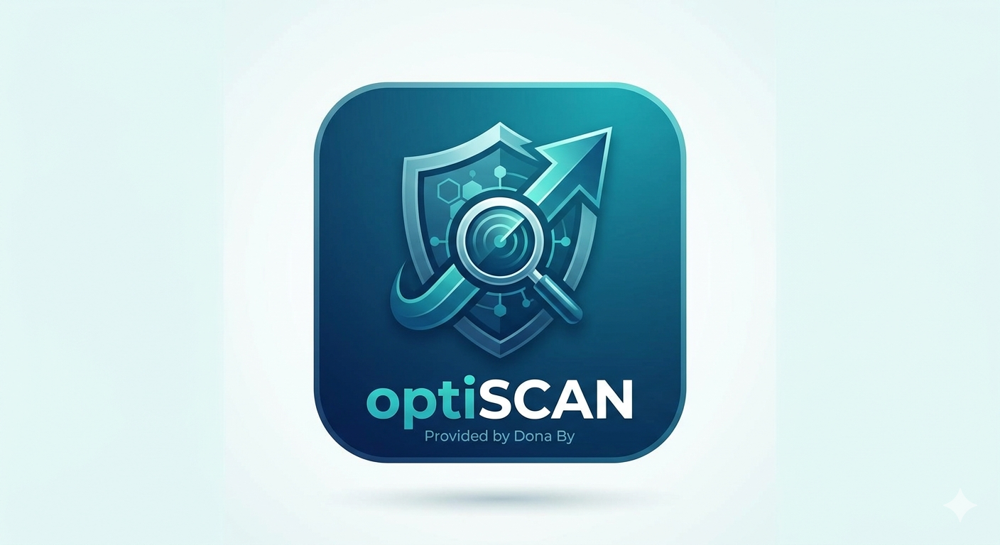
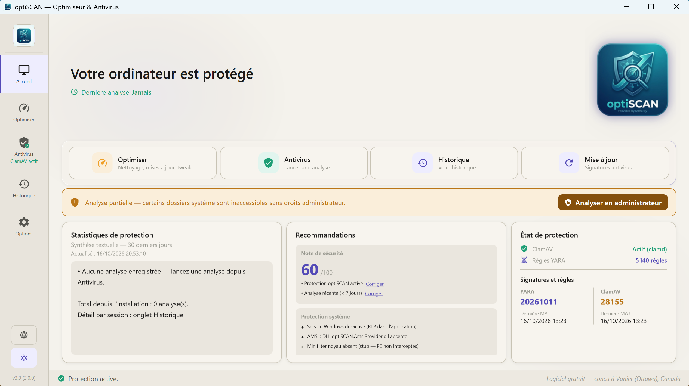
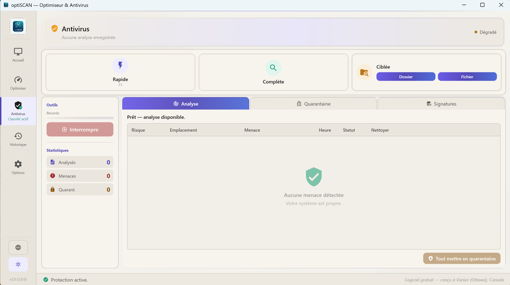
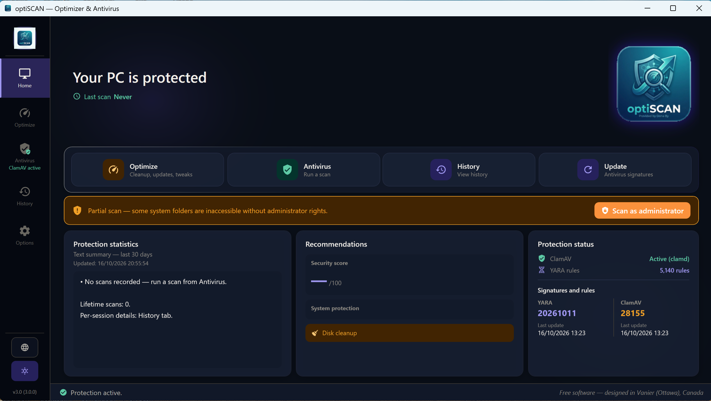
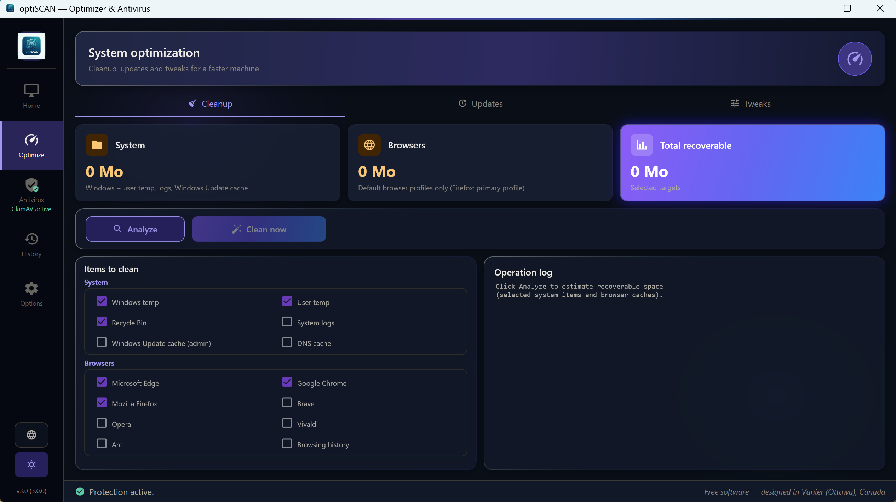
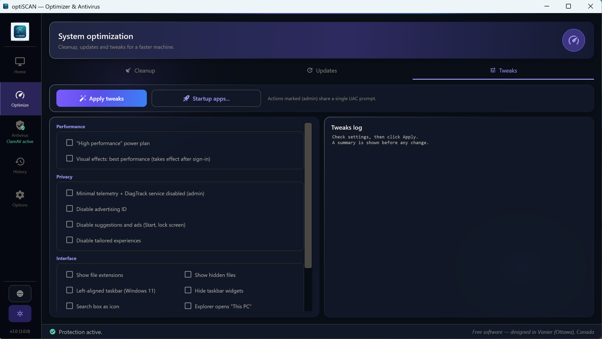
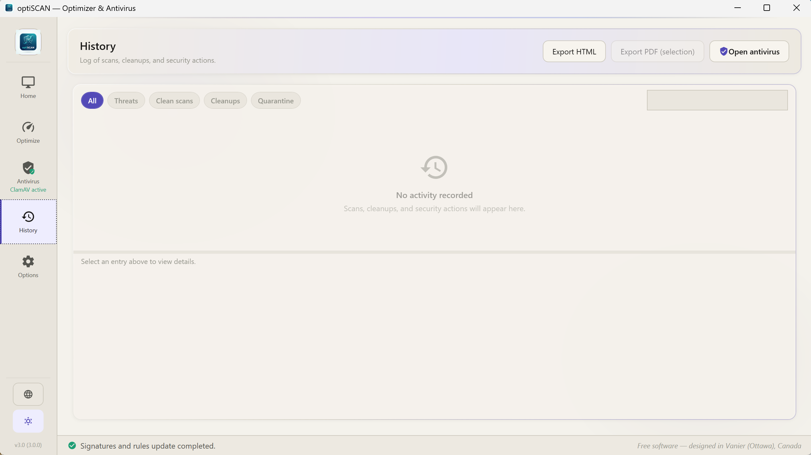
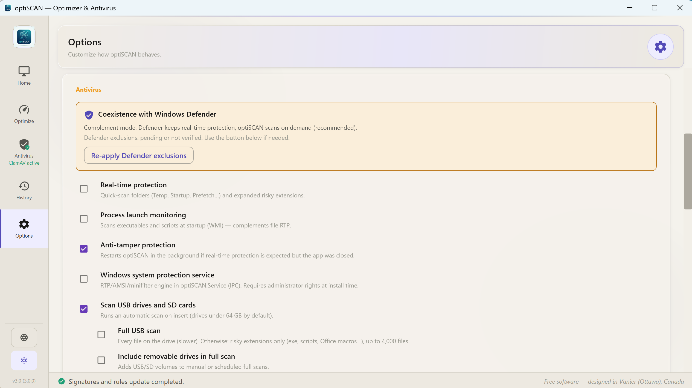

<p align="center">
  
</p>

<h1 align="center">optiSCAN</h1>

<p align="center">
  <strong>Antivirus et optimiseur libre et gratuit pour Windows, propulsé par ClamAV et YARA.</strong><br>
  Aucun compte, aucune publicité, aucune télémétrie.
</p>

<p align="center">
  <a href="https://sourceforge.net/projects/optiscan/files/optiSCAN_Setup_v3.0.0.exe/download"></a>
</p>

<p align="center">
  <a href="LICENSE.txt"></a>
  
  
  <a href="https://github.com/1donatien0/optiSCAN/actions/workflows/ci.yml"></a>
  <a href="https://github.com/1donatien0/optiSCAN/discussions"></a>
</p>

<p align="center">
  <a href="README.md">English</a> · Français
</p>

<p align="center">
  
</p>

## Pourquoi optiSCAN ?

La plupart des antivirus « gratuits » poussent vers une version payante, collectent des données ou affichent de la publicité. optiSCAN est une petite application Windows qui réunit deux moteurs de détection libres et reconnus, [ClamAV](https://www.clamav.net/) et [YARA](https://virustotal.github.io/yara/), derrière une interface claire, et y ajoute les outils de nettoyage qu'on paie d'habitude. Tout tourne en local, et le code source est ici, lisible par tous.

optiSCAN est conçu pour **fonctionner à côté de Windows Defender**, pas pour le remplacer.

## Fonctionnalités

**Antivirus**

- Analyse rapide, complète, d'un dossier ou d'un fichier, avec ClamAV et YARA en parallèle
- « Scanner avec optiSCAN » dans le clic droit de l'Explorateur
- Score de risque pour chaque menace (critique, majeur, mineur, informationnel)
- Quarantaine chiffrée (AES-256-GCM), avec restauration et suppression
- Mise à jour automatique des signatures et des règles (ClamAV toutes les 4 heures, règles YARA toutes les 24 heures)
- En option : protection en temps réel, analyse automatique des clés USB et cartes SD, analyse planifiée chaque jour
- Historique des analyses avec rapports PDF et HTML
- Note de sécurité du PC (pare-feu, UAC, Windows Update, partages) avec correction en un clic

**Optimiseur**

- Nettoyage des fichiers temporaires, des journaux Windows, de la corbeille et des caches de navigateurs (Edge, Chrome, Firefox, Brave, Opera, Vivaldi, Arc)
- Mise à jour des applications avec `winget`, en retirant les anciennes versions du même programme
- Réglages de performance, de confidentialité et d'interface, avec un bouton pour rétablir l'origine

**Interface**

- Français et anglais
- Thèmes clair, sombre et contraste renforcé ; suit le thème de Windows par défaut

## Captures d'écran

| Antivirus | Thème sombre (anglais) |
|:---:|:---:|
|  |  |
| **Nettoyage** | **Réglages (Tweaks)** |
|  |  |
| **Historique et rapports** | **Options** |
|  |  |

## Télécharger et installer

1. Téléchargez **[optiSCAN_Setup_v3.0.0.exe](https://sourceforge.net/projects/optiscan/files/optiSCAN_Setup_v3.0.0.exe/download)** (environ 29 Mo) sur SourceForge.
2. Lancez l'installateur et choisissez le français ou l'anglais.
3. Ouvrez optiSCAN, allez dans **Antivirus → Signatures** et cliquez sur **Mettre à jour** pour télécharger les signatures ClamAV et les règles YARA.

**Prérequis :** Windows 10 version 1809 ou plus récente, ou Windows 11, en 64 bits. Le runtime .NET est inclus dans l'installateur.

> **Avertissement Windows SmartScreen.** L'installateur n'est pas encore signé : Windows peut afficher « Windows a protégé votre ordinateur ». Cliquez sur **Informations complémentaires → Exécuter quand même**. La signature par la [SignPath Foundation](https://signpath.org/) est en cours ; voir la [politique de signature](docs/CODE_SIGNING_POLICY.md).

## Documentation

Le guide technique complet (architecture, modèle de sécurité, compilation, publication) : **[docs/GUIDE.md](docs/GUIDE.md)**.

## Compiler depuis les sources

```powershell
git clone https://github.com/1donatien0/optiSCAN.git
cd optiSCAN
.\scripts\fetch-runtime-deps.ps1      # télécharge les binaires ClamAV et YARA
dotnet build optiSCAN.sln -c Release
dotnet test --project optiSCAN.Tests\optiSCAN.Tests.csproj -c Release
```

Il faut Windows 10 ou 11 x64 et le SDK .NET 10. Pour l'installateur, il faut aussi Inno Setup 6 ; voir la section 8 du [guide](docs/GUIDE.md).

## Contribuer et obtenir de l'aide

- **Questions et idées :** [GitHub Discussions](https://github.com/1donatien0/optiSCAN/discussions)
- **Bogues et faux positifs :** [ouvrir une issue](https://github.com/1donatien0/optiSCAN/issues)
- **Failles de sécurité :** signalez-les en privé, comme indiqué dans [SECURITY.md](SECURITY.md)
- **Traductions et code :** les pull requests sont bienvenues. Les textes de l'interface sont dans `optiSCAN.Engine/Resources/UiStrings.resx` (français) et `UiStrings.en.resx` (anglais).

Si optiSCAN vous est utile, une ⭐ sur ce dépôt aide d'autres personnes à le découvrir.

## Licence

optiSCAN est un logiciel libre, distribué sous la [GNU General Public License v3 ou ultérieure](LICENSE.txt), sans aucune garantie. Les composants livrés gardent leur propre licence (ClamAV : GPL-2.0, YARA : BSD-3-Clause) ; voir les [avis de tiers](installer/licenses/THIRD-PARTY-NOTICES.md).

**Versions antérieures.** optiSCAN 1, 2 et 3 (tags `v1`, `v2`, `v3`) ont d'abord été distribués sous un contrat de licence utilisateur final (CLUF). Depuis le 16 octobre 2026, leur titulaire des droits les distribue, code source et installeurs, sous la GNU GPL v3 ou ultérieure. Cette déclaration remplace le CLUF présent dans `LICENSE.txt` de ces commits.

Conçu par **Donatien Byakombe (Dona By)** à Vanier (Ottawa), Canada.
