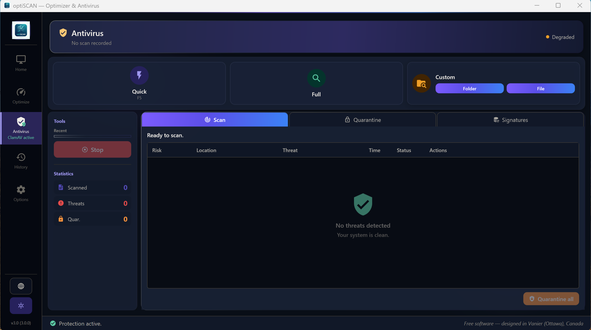
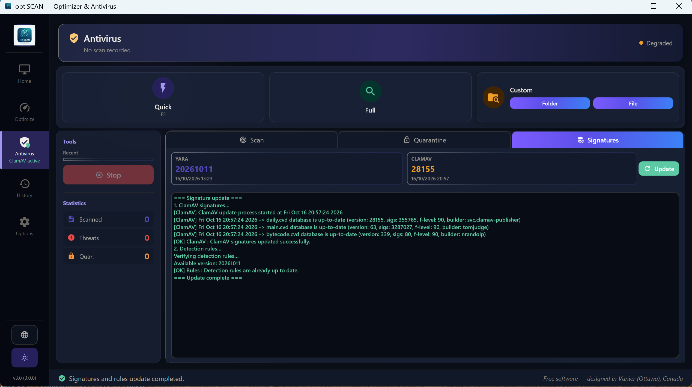
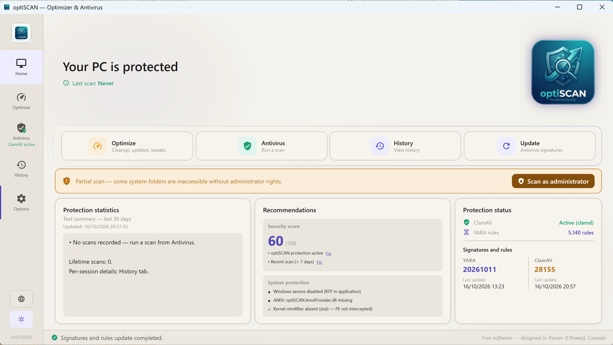

<p align="center">
  
</p>

<h1 align="center">optiSCAN</h1>

<p align="center">
  <strong>Free and open-source antivirus and PC optimizer for Windows, powered by ClamAV and YARA.</strong><br>
  No account, no ads, no telemetry.
</p>

<p align="center">
  <a href="https://sourceforge.net/projects/optiscan/files/optiSCAN_Setup_v3.0.0.exe/download"></a>
</p>

<p align="center">
  <a href="LICENSE.txt"></a>
  
  
  <a href="https://github.com/1donatien0/optiSCAN/actions/workflows/ci.yml"></a>
  <a href="https://github.com/1donatien0/optiSCAN/discussions"></a>
</p>

<p align="center">
  English · <a href="README.fr.md">Français</a>
</p>

<p align="center">
  
</p>

## Why optiSCAN?

Most "free" antivirus products push upgrades, collect data or show ads. optiSCAN is a small Windows app that puts two well-known open-source detection engines, [ClamAV](https://www.clamav.net/) and [YARA](https://virustotal.github.io/yara/), behind a clean interface, and adds the everyday cleanup tools people usually pay for. Everything runs locally, and the source code is here for anyone to read.

optiSCAN is designed to **work alongside Windows Defender**, not to replace it.

## Features

**Antivirus**

- Quick, full, folder and file scans, with ClamAV and YARA running in parallel
- "Scan with optiSCAN" in the File Explorer right-click menu
- Risk score for every threat (critical, major, minor, informational)
- Encrypted quarantine (AES-256-GCM), with restore and delete
- Automatic signature and rule updates (ClamAV every 4 hours, YARA rules every 24 hours)
- Optional real-time protection, automatic scan of USB drives and SD cards, scheduled daily scan
- Scan history with PDF and HTML reports
- Security score for your PC (firewall, UAC, Windows Update, shares) with one-click fixes

**Optimizer**

- Cleanup of temporary files, Windows logs, Recycle Bin and browser caches (Edge, Chrome, Firefox, Brave, Opera, Vivaldi, Arc)
- Application updates through `winget`, with older versions of the same program removed
- Performance, privacy and interface tweaks, with a button to restore the original settings

**Interface**

- English and French
- Light, dark and high-contrast themes, following the Windows theme by default

## Screenshots

| Antivirus | Signature updates |
|:---:|:---:|
|  |  |
| **Cleanup** | **Tweaks** |
|  |  |
| **History and reports** | **Options** |
|  |  |
| **Light theme** | **French interface** |
|  |  |

## Download and install

1. Download **[optiSCAN_Setup_v3.0.0.exe](https://sourceforge.net/projects/optiscan/files/optiSCAN_Setup_v3.0.0.exe/download)** (about 29 MB) from SourceForge.
2. Run the installer and choose English or French.
3. Open optiSCAN, go to **Antivirus → Signatures** and click **Update** to download the ClamAV signatures and YARA rules.

**Requirements:** Windows 10 version 1809 or later, or Windows 11, 64-bit. The .NET runtime is included in the installer.

> **Windows SmartScreen warning.** The installer is not code-signed yet, so Windows may show "Windows protected your PC". Click **More info → Run anyway**. Code signing through the [SignPath Foundation](https://signpath.org/) is in progress; see the [code signing policy](docs/CODE_SIGNING_POLICY.md).

## How it works

```
optiSCAN.exe (WPF interface)
    ├── ClamAV  (clamd, or clamscan.exe as a fallback)  ─┐
    └── YARA    (precompiled rules)                       ├── results merged, risk scored
                                                          ┘
optiSCAN.Service.exe (optional Windows service, SYSTEM)
    └── real-time protection, USB scans, AMSI script scanning
```

The engines run in a sandbox (AppContainer) without network access. The full technical guide, in French, covers the architecture, security model, build and release process: **[docs/GUIDE.md](docs/GUIDE.md)**.

## Build from source

```powershell
git clone https://github.com/1donatien0/optiSCAN.git
cd optiSCAN
.\scripts\fetch-runtime-deps.ps1      # downloads ClamAV and YARA binaries
dotnet build optiSCAN.sln -c Release
dotnet test --project optiSCAN.Tests\optiSCAN.Tests.csproj -c Release
```

You need Windows 10 or 11 x64 and the .NET 10 SDK. Building the installer also needs Inno Setup 6; see section 8 of the [guide](docs/GUIDE.md).

## Roadmap

Version 3.1 is in preparation: a separate scanning engine, AMSI script scanning shipped with the service, and signed binaries. See the [release plan](RELEASE_PLAN_v3.1.md) and the [roadmap](ROADMAP.md).

## Contributing and support

- **Questions and ideas:** [GitHub Discussions](https://github.com/1donatien0/optiSCAN/discussions)
- **Bugs and false positives:** [open an issue](https://github.com/1donatien0/optiSCAN/issues)
- **Security vulnerabilities:** please report them privately, as described in [SECURITY.md](SECURITY.md)
- **Translations and code:** pull requests are welcome. Interface strings live in `optiSCAN.Engine/Resources/UiStrings.resx` (French) and `UiStrings.en.resx` (English).

If optiSCAN is useful to you, a ⭐ on this repository helps other people find it.

## License

optiSCAN is free software, released under the [GNU General Public License v3 or later](LICENSE.txt), without any warranty. Bundled components keep their own licenses (ClamAV: GPL-2.0, YARA: BSD-3-Clause); see the [third-party notices](installer/licenses/THIRD-PARTY-NOTICES.md).

**Earlier versions.** optiSCAN 1, 2 and 3 (tags `v1`, `v2`, `v3`) were first distributed under an end-user license agreement. Since October 16, 2026, their copyright holder has distributed them, source code and installers, under the GNU GPL v3 or later. This notice replaces the end-user license agreement found in `LICENSE.txt` in those commits.

Made by **Donatien Byakombe (Dona By)** in Vanier (Ottawa), Canada.
